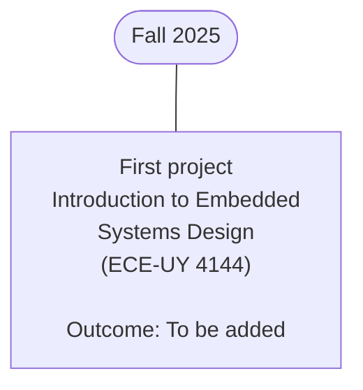

# Letter of Recommendations for Bao

For Professor Matthew Campisi.

## Schools List and Deadlines

| School | Letter Deadline |
| --- | --- |
| University of California, Los Angeles | December 31, 2026 |
| University of California, Berkeley | January 5, 2027 |
| Columbia University | January 14, 2027 |
| Northwestern University | January 14, 2027 |
| University of Michigan | January 14, 2027 |
| Carnegie Mellon University | January 14, 2027 |
| Cornell University | January 14, 2027 |
| Cornell Tech | January 14, 2027 |
| University of Pennsylvania | January 14, 2027 |

## Academic Performance

### My Courses with You

- Signals and Systems (ECE-UY 3054): A
- Introduction to Embedded Systems Design (ECE-UY 4144): A
- Real-Time Embedded Systems (ECE-GY 6483)
- Impact Innovation Lab (ECE-UY 4423)

### General

- Overall GPA: 3.677/4.000
- Major Requirement GPA: 3.677/4.000
- Advanced GPA (final 2 years): 3.896/4.000

## Resume

[View my resume (PDF)](Bao-Nguyen_resume.pdf)

## How You Know Me

### My Courses With You

- Signals and Systems (ECE-UY 3054): A
- Introduction to Embedded Systems Design (ECE-UY 4144): A
- Real-Time Embedded Systems (ECE-GY 6483)
- Impact Innovation Lab (ECE-UY 4423)

### Research

- Dorsal root ganglion signal processing research with Dr. Mammis.

### Projects

- Smart Watch personal project with the Seeed Studio XIAO nRF52840 Sense Plus.
- MaGlovin, a magnetic teleoperation glove, for Impact Innovation Lab (ECE-UY 4423).

## Specific Work You Have Seen Me Do

## 2-3 Qualities I Hope You Will Highlight

## What I Am Applying For and Why
